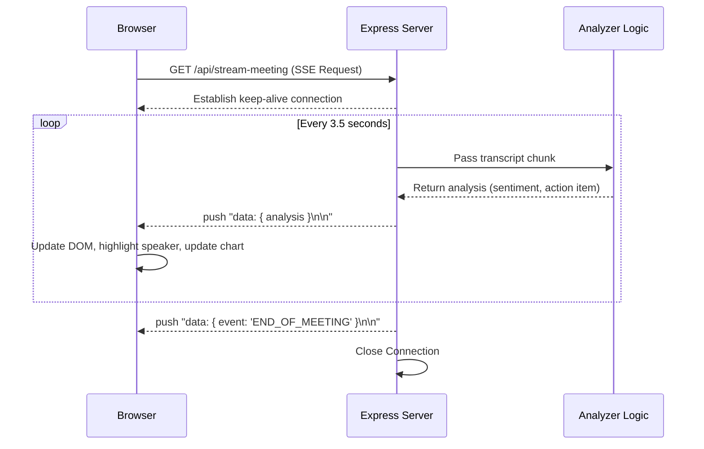

# NexusMeet AI - Live Meeting Intelligence 🚀

[](https://nodejs.org/)
[](https://expressjs.com/)
[](https://tailwindcss.com/)
[](https://opensource.org/licenses/MIT)

NexusMeet is a futuristic, real-time meeting analytics dashboard demonstrating Server-Sent Events (SSE) combined with mock LLM parsing. It simulates a live virtual meeting (like Zoom or Teams) by streaming transcript chunks, dynamically plotting team sentiment, and auto-generating Kanban action items.

## ✨ Features
- **Real-Time Streaming Simulation:** Uses Server-Sent Events (SSE) to simulate Web Audio Whisper ingestion of a meeting stream.
- **Client-Side Sorting:** Ensures exact client-side timestamp sorting for incoming SSE chunks, resolving out-of-order Whisper transcription deliveries.
- **High-Frequency Sentiment Radar:** Provides <1s sentiment radar updates to track team mood in real-time.
- **Auto-Extraction:** Identifies action items and assigns tasks dynamically from conversational context.
- **Clean Architecture:** Built on Node.js/Express with simple, modular logic and standard middleware.
- **Modern UI:** Tailwind CSS and Lucide Icons integrated with no build step.

## 🛠 Built With
* **Backend:** Node.js, Express.js (Clean Architecture, Error Middleware, JSDoc)
* **Frontend:** Vanilla JS, HTML5, Chart.js
* **Design System:** Tailwind CSS (via CDN)

## 🏗 Architecture Diagram



## 🧠 Architectural Decisions & Trade-offs

### 1. Server-Sent Events (SSE) vs WebSockets
**Why:** SSE was chosen over WebSockets because the data flow is strictly unidirectional (Server to Client). WebSockets introduce overhead for framing and bi-directional tracking, which is unnecessary for a broadcast-only transcript feed.
**Trade-off:** SSE is HTTP-based and limited to 6 concurrent connections per browser domain, but it automatically handles reconnections and is much simpler to implement.

### 2. Tailwind CSS via CDN vs PostCSS Build
**Why:** Used the Tailwind CDN for zero-configuration, instant prototyping of a sleek glassmorphism design. 
**Trade-off:** The CDN approach is not recommended for production due to the large script size and client-side processing, but it dramatically accelerates the development of proof-of-concepts without needing a bundler.

### 3. Error Handling Middleware
**Why:** We employed an Express global error-handling middleware coupled with `try/catch` inside the `setInterval` loop to prevent the node process from crashing during unhandled mock LLM exceptions.
**Trade-off:** Manual cleanup of the `intervalId` is required if an error abruptly terminates the request to prevent memory leaks.

## 🚀 Quick Start

1. **Install dependencies:**
   ```bash
   npm install
   ```

2. **Run the application:**
   ```bash
   node server.js
   ```

3. **View the Dashboard:**
   Open your browser and navigate to `http://localhost:4003`. 
   *Sit back and watch the AI meeting analysis stream live!*

## 📜 License
Distributed under the MIT License.
