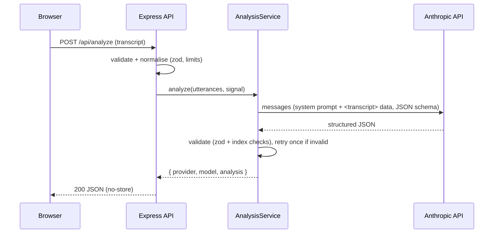

# NexusMeet – AI Meeting Analyzer

[](https://github.com/codebyjuliamendes/ai-meeting-analyzer/actions/workflows/ci-cd.yml)


[](LICENSE)

Meetings produce long transcripts that nobody re-reads. NexusMeet turns a transcript into a short report:
summary, overall and per-utterance sentiment, action items (who, what, by when), decisions, and risks/blockers.

It has two parts:

- **Analyze transcript** – paste a `Speaker: text` transcript and get a structured report produced by
  Claude (Anthropic API). Without an API key the server runs in a clearly labelled **demo mode** that uses
  simple keyword heuristics instead of an AI model.
- **Live demo** – a scripted, fictional meeting streamed over Server-Sent Events (SSE), showing live
  transcript, speaker highlight, action items and a sentiment chart. It always uses the demo heuristics.

## Features

- Real LLM analysis with **structured outputs** (JSON Schema) and **server-side validation** (Zod) of every
  response, including range checks and references back to existing utterances.
- **Timeouts and retries**: per-attempt timeout and SDK retries for 429/5xx/network errors, an overall
  deadline, cancellation when the client disconnects, and one extra attempt if the model output fails validation.
- **Prompt-injection hardening**: the transcript is passed as delimited data (one JSON object per line inside a
  single `<transcript>` block, with `<`, `>` and `&` escaped so content cannot close the block); the system prompt
  tells the model never to follow instructions found in the transcript; output is schema-constrained and
  re-validated.
- **Transcripts treated as sensitive data**: never stored, never logged (logs contain only method, path, status,
  duration and counts; bodies are redacted), responses sent with `Cache-Control: no-store`.
- Live SSE replay with client-side ordering by spoken timestamp (chunks deliberately arrive out of order).
- Accessible, responsive UI (390px+) with light/dark themes, keyboard-navigable tabs, visible focus, loading,
  empty and error states, and double-submit protection. No CDN scripts: Chart.js and Swagger UI are served locally.
- OpenAPI docs at `/api-docs`.

## Quick start

Requirements: Node.js 22+.

```bash
npm ci
cp .env.example .env          # optional; every variable has a default
npm start                     # http://localhost:4003
```

Without `ANTHROPIC_API_KEY` the app starts in demo mode (shown in the UI and logs). For real analysis:

```bash
ANTHROPIC_API_KEY=sk-ant-... npm start
```

> The app does not load `.env` by itself; export the variables or use `node --env-file=.env server.js`.

### Docker

```bash
docker compose up --build                       # demo mode
ANTHROPIC_API_KEY=sk-ant-... docker compose up --build
```

The image is multi-stage, runs as the non-root `node` user, contains only production dependencies and has a
`HEALTHCHECK` on `/healthz`. Compose runs it with a read-only filesystem and all capabilities dropped.

## Configuration

All configuration comes from environment variables and is validated at boot; invalid values stop the process
with a clear message.

| Variable                              | Default            | Description                                                                           |
| ------------------------------------- | ------------------ | ------------------------------------------------------------------------------------- |
| `PORT` / `HOST`                       | `4003` / `0.0.0.0` | Listen address                                                                        |
| `LOG_LEVEL`                           | `info`             | pino log level                                                                        |
| `TRUST_PROXY`                         | `false`            | Express `trust proxy` (set behind a reverse proxy so rate limits see real client IPs) |
| `AI_PROVIDER`                         | `auto`             | `auto` (Anthropic if a key is set, else demo), `anthropic` (key required), `demo`     |
| `ANTHROPIC_API_KEY`                   | –                  | Anthropic API key. Keep it in a secret store, never in the repo                       |
| `ANTHROPIC_MODEL`                     | `claude-opus-5-5`  | Claude model ID                                                                       |
| `ANTHROPIC_EFFORT`                    | `medium`           | `low` … `max` (cost/quality trade-off)                                                |
| `ANTHROPIC_FALLBACKS`                 | `default`          | `default` enables the server-side refusal fallback (beta); `off` disables it          |
| `ANTHROPIC_BASE_URL`                  | –                  | Optional API base URL (e.g. a gateway)                                                |
| `AI_TIMEOUT_MS`                       | `60000`            | Per-attempt timeout. Overall deadline is `2 × AI_TIMEOUT_MS + 5s`                     |
| `AI_MAX_RETRIES`                      | `2`                | SDK retries for 429/5xx/connection errors                                             |
| `ANALYZE_RATE_LIMIT_PER_MIN`          | `10`               | `POST /api/analyze` requests per client IP per minute                                 |
| `MAX_TRANSCRIPT_CHARS`                | `60000`            | Maximum transcript size                                                               |
| `MAX_CONCURRENT_STREAMS`              | `50`               | Maximum simultaneous SSE replays                                                      |
| `STREAM_STEP_MS` / `STREAM_JITTER_MS` | `2500` / `2000`    | Live replay pacing / simulated out-of-order delay                                     |
| `SHUTDOWN_TIMEOUT_MS`                 | `10000`            | Grace period before forced exit on SIGTERM                                            |
| `ENABLE_API_DOCS`                     | `true`             | Serve `/api-docs`                                                                     |

## API

| Method & path              | Description                                                                                                                                                      |
| -------------------------- | ---------------------------------------------------------------------------------------------------------------------------------------------------------------- |
| `POST /api/analyze`        | Body: `{ "text": "Ana: ...\nBruno: ..." }` or `{ "utterances": [{ "speaker", "text" }] }`, optional `title`. Returns `{ provider, model, analysis, utterances }` |
| `GET /api/stream-meeting`  | SSE replay of the demo meeting (`MEETING_START`, `UTTERANCE`, `END_OF_MEETING`, …)                                                                               |
| `GET /api/config`          | Active provider (`anthropic` or `demo`) and limits                                                                                                               |
| `GET /healthz` / `/readyz` | Liveness / readiness (readiness returns 503 while draining)                                                                                                      |
| `GET /api-docs`            | Swagger UI for `public/swagger.json`                                                                                                                             |

Errors share one shape: `{ "error": { "code", "message", "details?", "requestId" } }`. Provider failures map
to stable codes: `ai_timeout` (504), `ai_rate_limited` (503), `ai_unavailable` / `ai_invalid_output` /
`ai_misconfigured` (502), `ai_refused` (422).

## Architecture

```
server.js                 boot: config → logger → provider → service → app; graceful shutdown
src/config.js             env validation (zod), fail fast
src/logger.js             pino JSON logs with redaction
src/domain/               pure, tested logic
  schemas.js              request/analysis schemas, JSON Schema for structured outputs, validation
  transcript.js           "Speaker: text" parsing, normalisation and limits
  prompt.js               system prompt + delimited transcript block
  demoAnalyzer.js         deterministic keyword heuristics (demo mode / live replay)
  demoMeeting.js          scripted fictional meeting
src/providers/            AnalysisProvider implementations
  anthropicProvider.js    Anthropic Messages API (structured outputs, refusal handling, error mapping)
  index.js                provider selection + demo provider
src/services/analysisService.js   deadline, cancellation, invalid-output retry, validation
src/http/                 error mapping, SSE replay handler
src/app.js                Express app: helmet/CSP, compression (not for SSE), rate limits, routes
public/                   static UI (vanilla JS, no build step)
```



### Decisions and trade-offs

- **Provider interface + demo mode.** The app is usable without credentials (portfolio/demo deployments), but
  demo output is always labelled as heuristics – in the API (`provider: "demo"`), in the UI badge/banner and in
  the result itself – so it is never mistaken for AI output.
- **Structured outputs + local validation.** The JSON Schema constrains the model's output shape; Zod then
  enforces ranges, lengths and that every referenced utterance exists. Invalid output is never returned.
- **SSE instead of WebSockets** for the replay: the flow is one-way. Compression is disabled for
  `text/event-stream`, `X-Accel-Buffering: no` is sent and a heartbeat comment keeps proxies from closing idle
  connections.
- **No CDN / no Tailwind runtime.** The previous UI loaded Tailwind, Chart.js and Lucide from CDNs, which Helmet's
  default CSP blocked. Assets are now local, which allows a strict `script-src 'self'` CSP.
- **In-memory rate limiting.** Simple and dependency-free; with several replicas each instance counts
  separately (use a shared store such as Redis if strict global limits are needed).

## Quality

```bash
npm run lint          # ESLint
npm run format:check  # Prettier
npm run typecheck     # TypeScript checkJs over JSDoc types
npm test              # node:test + supertest (LLM always mocked)
npm run check         # all of the above
```

Tests cover domain logic (parsing, heuristics, validation, prompt delimiting), the Anthropic provider with a
mocked client (request shape, refusals, truncation, invalid JSON, SDK error mapping), the analysis service
(retry, deadline/abort) and the HTTP layer (validation, limits, error mapping without leaks, rate limiting,
security headers, SSE stream, stream cap and draining). No test calls the real API.

CI (GitHub Actions) runs lint, format check, typecheck, tests and `npm audit`, then builds the Docker image and
smoke-tests the running container in demo mode.

## Deployment

- **Docker / Compose**: see above.
- **Kubernetes**: `k8s/` contains a Deployment (non-root, read-only root FS, startup/liveness/readiness probes,
  API key from an optional Secret `ai-meeting-analyzer` / key `anthropic-api-key`), a Service and an nginx Ingress
  configured for SSE. Replace the image with your registry image. Create the secret with:
  `kubectl create secret generic ai-meeting-analyzer --from-literal=anthropic-api-key=...`

## Privacy

When an API key is configured, transcripts are sent to Anthropic for processing; review Anthropic's data
retention terms before analyzing confidential meetings. This server does not store transcripts or analysis
results and does not log their content.

## Limitations

- There is no authentication: anyone who can reach the server can use the analysis endpoint (and your API
  quota). Put it behind your SSO/reverse proxy for anything beyond a personal demo; rate limiting only reduces abuse.
- The live view is a scripted replay; there is no audio capture or real-time transcription.
- Demo-mode heuristics are English keyword rules and are intentionally naive.
- AI analysis can be wrong; the UI says so and shows the transcript next to the results.
- Very long transcripts must be under `MAX_TRANSCRIPT_CHARS`; there is no chunking.

## License

[MIT](LICENSE) © Júlia Mendes
