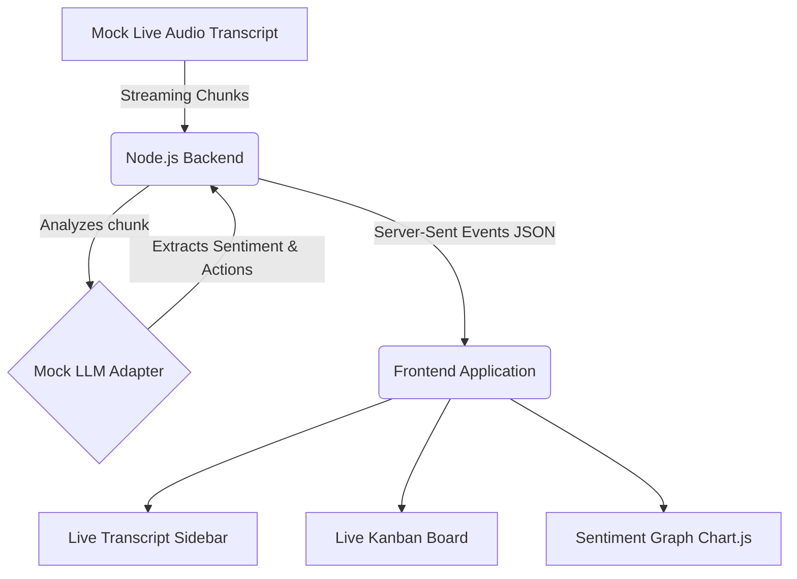

# Live Meeting Intelligence

A futuristic AI portfolio project demonstrating real-time analysis of a live meeting transcript using Server-Sent Events (SSE).

## 🚀 The Scenario

This project simulates a live team meeting where three participants (Alice, Bob, and Charlie) discuss building a new analytics dashboard. As they speak, their conversation is streamed to the frontend, simulating real-time audio transcription.

Simultaneously, a mock AI (acting as an LLM stream processor) analyzes the chunks on the fly and:
- Extracts **Action Items** and assigns them to the right person, mapping them to a Kanban board.
- Analyzes the **Sentiment / Tension** of the conversation, updating a live Chart.js sparkline graph in real-time.

All of this happens autonomously. There are no submit buttons; you just watch the magic happen.

## 🏗️ Architecture



## 🛠️ Tech Stack
- **Backend:** Node.js, Express, Server-Sent Events (SSE)
- **Frontend:** HTML5, CSS Grid, Vanilla JS
- **UI Design:** Dark mode, Glassmorphism, CSS Animations
- **Visualizations:** Chart.js

## 🌟 The "Why"
This project demonstrates the ability to build seamless, autonomous, real-time AI interfaces. Instead of standard "Chatbots", the future of AI is ambient intelligence—agents that listen, understand, and organize information for us while we focus on the human conversation.

## ⚖️ Trade-offs
- **Mocked LLM:** To ensure this runs locally without API keys and without latency issues for a portfolio demo, the LLM is mocked via heuristic analysis and `setTimeout` to mimic realistic API delays. It's designed in a way that the `analyzeTranscriptChunk` function could easily be swapped out for a real OpenAI/Gemini call in the future.
- **SSE vs WebSockets:** Used SSE instead of WebSockets because the communication is strictly unidirectional (Server to Client). SSE is lighter, built-in to HTTP, and perfect for streaming LLM responses.

## 🏃 Quick Start

1. Install dependencies:
   ```bash
   npm install
   ```
2. Start the server:
   ```bash
   npm start
   # or
   node server.js
   ```
3. Open your browser and navigate to:
   ```
   http://localhost:3000
   ```
4. Sit back and watch the meeting unfold!
